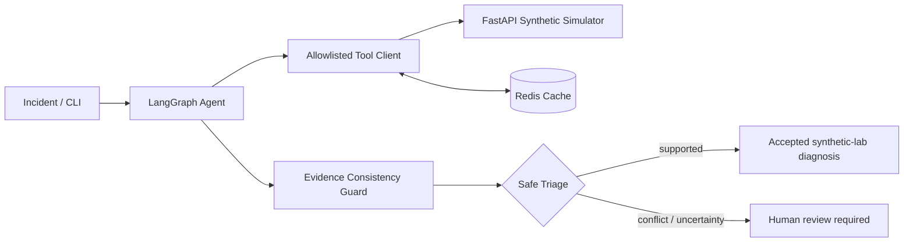

# AI-Powered Network Operations Agent

[](https://github.com/OWNER/REPO/actions/workflows/ci.yml)

> **Synthetic research lab** for bounded, tool-using network incident triage. Not an autonomous production operator. No live equipment or remediation actions.

## Overview

This project connects a Python/FastAPI simulated network-incident system to a LangGraph agent that can select and execute allowlisted diagnostics (`ping`, `dns_query`, `bgp_status`, `interface_counters`, `cpu_process`, `optical_power`). OpenAI mode uses a real LLM for planning and classification; **mock mode is deterministic and is not AI accuracy evidence**.

Features: typed tool validation; timeouts and retries; optional Redis caching; evidence-aware early stopping; a bounded evidence-consistency recheck; safe triage that withholds acceptance and flags human review when evidence contradicts the diagnosis; structured trace/evaluation harness; Docker and GitHub Actions CI.

## Architecture



## Quick start with Docker (no API key needed)

Prerequisites: Docker Desktop with running Linux Docker Engine, Docker Compose.

```powershell
docker compose up --build -d simulator redis
docker compose exec redis redis-cli ping
python scripts/stage6_smoke.py --base-url http://127.0.0.1:8000
docker compose run --rm agent --incident-id INC-0001 --mode mock --cache redis
```

The API is available at <http://127.0.0.1:8000/docs>. The mock agent uses a deterministic heuristic; use it for **smoke tests only**.

For a billed OpenAI demonstration, put an **untracked** `OPENAI_API_KEY` in `.env` then run:

```powershell
docker compose run --rm agent --incident-id INC-0001 --mode openai --cache redis --early-stop on --consistency-guard on
```

You are charged by OpenAI API usage. Do not publish `.env` or paste the key in issues, screenshots, or commits. Docker container administrators can inspect the environment; this pattern is only for a local demonstration.

## Windows native development

```powershell
py -3.12 -m venv .venv
.\.venv\Scripts\Activate.ps1
python -m pip install -e ".[dev]"
python -m pytest -q
python -m uvicorn netops_agent.api:app --reload
```

In a second activated terminal: `python scripts/run_agent.py --incident-id INC-0001 --mode mock --cache off`.

## Evaluation results — fixed 30-case synthetic lab validation

| Metric | Value |
| --- | ---: |
| Raw LLM diagnostic accuracy | 29/30 (96.67%) |
| Autonomous coverage | 29/30 (96.67%) |
| Selective accuracy on accepted cases | 29/29 (100%) |
| Incorrectly accepted | 0 in this sample |
| Human review / execution failure | 1 / 0 |
| Mean / p50 latency | 4.15s / 3.29s |
| p95 / max latency | 9.06s / 13.60s |
| Mean probes / HTTP calls | 1.53 / 4.60 |

Model: `gpt-4.1-mini` with early stopping and consistency guard on, cache off. These are **observed in 30 synthetic cases**, not a production reliability guarantee or a 200-case OpenAI evaluation. Confidence is not calibrated. The p95 is a noisy small-sample nearest-rank estimate. No validated 87% vs 72% or 6.1s -> 3.8s p95 claims are made. For reproducing new evaluations, see the `docs/` guides; evaluators read private labels only after public inference. Use an unseen final holdout for an unbiased assessment after any further tuning.

## Project structure

- `src/netops_agent/` — simulator, LangGraph decision workflow, evidence verifier and resilient tool client
- `scripts/` — CLI tools, synthetic dataset generation and evaluation
- `tests/` — reproducible automated tests
- `data/incidents_v1.jsonl` — public synthetic demonstration dataset only
- `docs/` — architecture, benchmarking and engineering decisions
- `.github/workflows/ci.yml` — offline CI pipeline

## Quality and security

- `python -m pytest -q` — unit/integration tests
- `python scripts/release_check.py` — static release protection
- `python scripts/stage6_smoke.py --base-url http://127.0.0.1:8000` — API smoke test
- `.github/workflows/ci.yml` — Python tests and offline Docker Compose smoke test, with no paid LLM API requests
- Synthetic read-only tooling only; no shell execution or network device remediations

See [Stage 6 deployment and GitHub guide](docs/STAGE6_RELEASE_GUIDE.md) and prior engineering docs under `docs/`.

## Publishing

For GitHub publishing instructions (including the security checklist), see [GitHub Upload Guide](GITHUB_UPLOAD_GUIDE.md). Public repository creation and CI execution must be performed by the repository owner.
